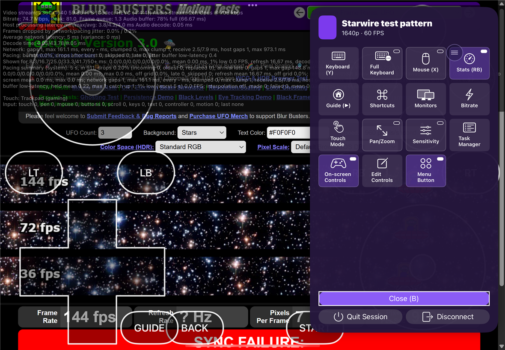
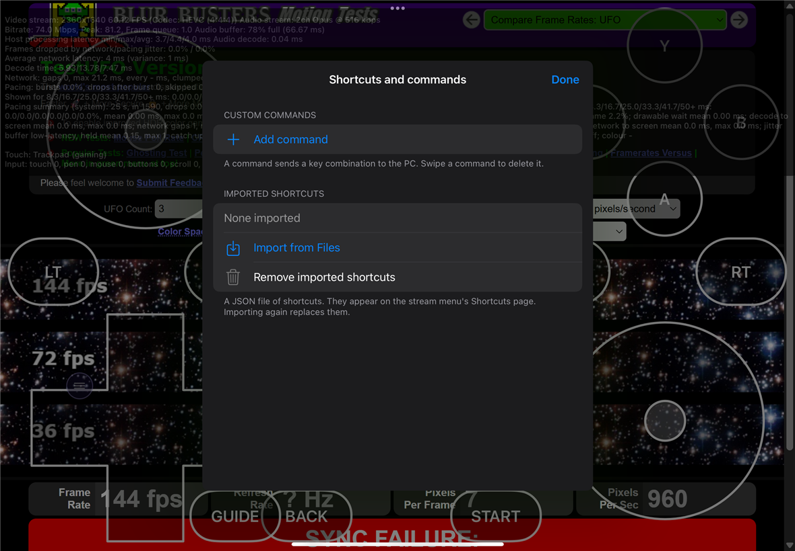
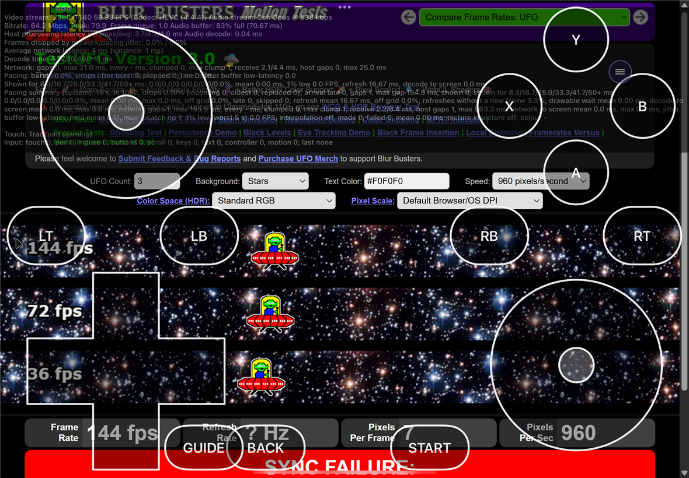
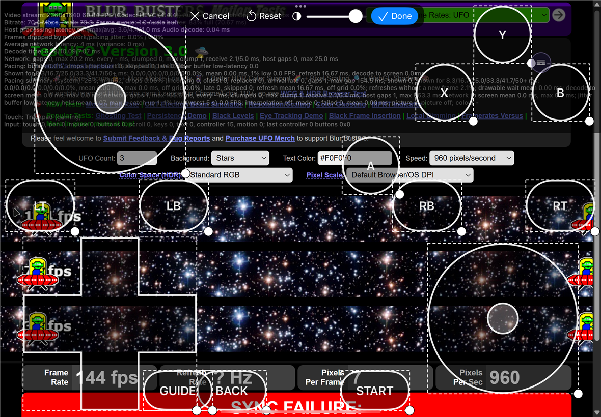
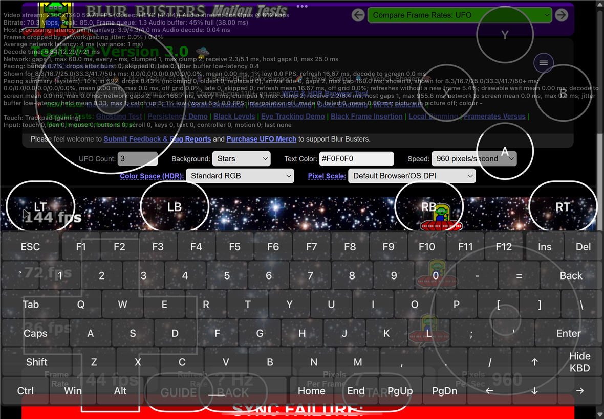
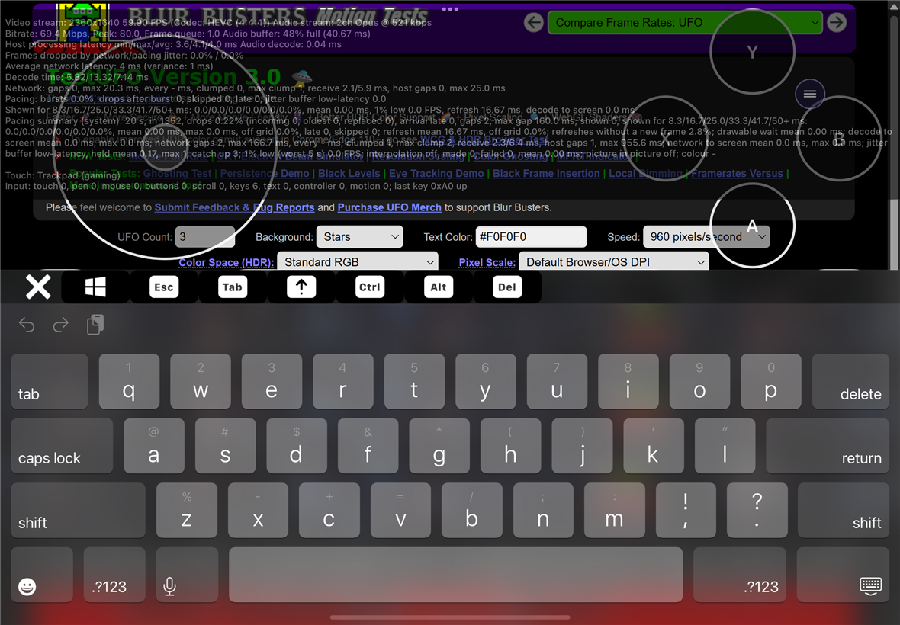

# Device run: feature/ios-batch-3, 2026-10-25

Batch 3 is phase 5 of [the plan](../port-plan.md): input. Every build, install and test was
started from the Windows PC with `ios/scripts/mac.sh`, with nobody at the Mac or the iPad. The
controller hands-on session was postponed by the owner to the end of the port, so everything
that needs a controller, a Pencil, a keyboard or a mouse is "built, not verified" below.

## What was run

| | |
| --- | --- |
| Date and time (UTC) | 25 Oct 2026, about 15:40 to 16:40 |
| Branch and commit | `feature/ios-batch-3`, from `2eea78ae` (input on the stream screen) to `f4f37b12` (Manage sheet) |
| Who ran it | Claude Code on the Windows PC, through `mac.sh` |
| Mac | MacBook Air (M1, 2020), macOS 27.0.1, Xcode 27.0 |
| iPad | **iPad (10th generation)**, iPad13,18, iPadOS 18, 60 Hz, no Pencil. The iPad Pro (M4) was in someone else's use and was not touched: `mac.sh` now refuses to pick an iPad when two are connected and none is named |
| Bundle ID and signing | `io.github.shev0k.starwire`, the same free personal team. The test runner needed the 10th gen in its profile (`mac.sh build` now signs for the named iPad) and a free app slot: Aidoku was removed with the owner's OK |
| Build configuration | Release on the iPad; Debug, signed ad hoc, for the simulator tests |
| PC and host | Vibeshine 2.0.1. The "Starwire test pattern" app on its own virtual display |
| Stream | 2360x1640, 60 FPS, HEVC (`FPS=60 CODEC=hevc`) |
| Network | iPad on Wi-Fi, PC wired |

## Tests

| Test | Result | Notes |
| --- | --- | --- |
| `swift test` for StarwireKit | 381 passed | On Windows and on the Mac. The input logic and its timings, with injected time |
| Unit tests on the simulator | 129 passed | |
| `InputDeviceRunTests/testTouchModes` | passed | See below |
| `InputDeviceRunTests/testStreamMenu` | passed | |
| `InputDeviceRunTests/testOnScreenControls` | passed | |
| `InputDeviceRunTests/testKeyboards` | passed | |
| `testBitrateChange` (now from the menu) | passed | 20 then 80 Mbps applied by the PC |
| `testStreamAndSample`, 60 s | passed | 0.10% drops at 60 FPS |
| `testStreamsInARow`, 3 streams | passed | |
| `testBackgroundAndResume` | passed | |
| `testRemoteInput` | passed | |

The device tests read what reached the PC from a new line in the statistics overlay,
`Input: touch 0, pen 0, mouse 12, buttons 4, ...; last button 1 up`, which counts every packet the
app sends by kind (StarwireKit's `InputTally`). The exact packets for each gesture are asserted
by the StarwireKit tests.

## Touch

| Check | Result |
| --- | --- |
| Start mode | Gaming trackpad, from "Use the touchscreen as a trackpad" (on by default) |
| Gaming trackpad | A tap clicked (button 1 down and up), a drag moved the mouse, a two-finger tap right clicked |
| Natural trackpad | A tap clicked, a drag moved the mouse |
| Direct touch | A tap sent a position, then a click; a 1.2 s press was a right click |
| Swapped clicks | A tap was a right click |
| Three-finger tap | Opened the menu with no click in the trackpad and direct modes |
| Multi-touch | A tap went to Vibeshine as two touch events; three fingers went as six and didn't open the menu |
| Touch disabled | Nothing sent; three fingers opened the menu as they landed |
| Pinch to zoom | No click (the zoomed picture itself was not checked by eye) |
| Pan and zoom mode | Nothing sent to the PC; a double tap reset the zoom |

Two things found and fixed on the way:
1. **A two-finger tap wasn't a right click** at first. UIKit reports both fingers lifting in one
   event, and the app handled the first finger first, which Android treats as a different
   gesture. Fingers lifting together now go last-touched first.
2. **Changing the touch mode right after a tap sent a stray button release** (the counts showed
   an odd number of button packets). Android's contexts do the same. Fixed, with a regression
   test.

## Stream menu

The floating button (draggable, its spot saved per orientation) and the three-finger tap open
it. Every tile listed in [parity.md](../parity.md) was there, and nothing for clipboard or PC
commands. The Stats switch hid and showed the overlay, Esc on the Shortcuts page reached the PC,
the Monitors page listed six, and Manage opened the custom commands editor and the shortcut
import. Bitrate moved into the menu.

## On-screen controller and keyboards

| Check | Result |
| --- | --- |
| On-screen controller | Already on at the start (moonlight-ios's old setting migrated as "show"); the menu's switch turned it off and on |
| A button | Pressed and released on the PC (controller packets) |
| Left stick | Moved, then back to idle |
| Layout editor | Moved A, Done saved it, Reset put it back; nothing reached the PC while editing |
| Full keyboard | A sent 0x41; Shift held 0.6 s locked it and the next A carried the Shift flag; Hide closed it |
| System keyboard | "h" and "i" went to the PC as UTF-8 text, Return as Enter (0x0D) |

The default on-screen layout is Android's, scaled to the screen's height, so on an iPad the
sticks and d-pad are large. The editor resizes them.

## Not verified on this device

- **Controllers** (DualSense, FlyDigi Apex 5, the phone grip): buttons, sticks, triggers, rumble,
  trigger rumble, adaptive triggers, LED, battery, the Home button staying in the app, holding a
  button to open the menu, mouse emulation, touchpad as mouse, multiple controllers, and which
  profile the Apex 5 shows as on iOS. Postponed by the owner; the checklist is below.
- **Vibeshine's DualSense haptics** (0x5601): no game with DualSense haptics was run.
- **The device's motion sensors for a controller** and **vibration for rumble** (iPhone only).
- **Apple Pencil** (pressure curves, tilt, hover): no Pencil for this iPad. Needs the iPad Pro.
- **Hardware keyboard and mouse**, pointer lock, back and forward buttons: none available.
- **Hide the PC cursor** and **monitor switching**: whether Vibeshine has the Ctrl+Alt+Shift+N
  toggle and the F1 to F6 display switch is not checked. Monitor switching wasn't pressed, since
  it would change what the PC streams.
- **Importing a shortcut file** and **saving a custom command**: the sheet opened; nothing was
  imported or saved.
- **120 Hz and the iPad Pro's own feel**: this iPad runs at 60 Hz.

## Hands-on checklist for the end of the port

About 10 minutes, on the iPad with the app log over SSH
(`ios/scripts/mac.sh log 900 -StarwireVerboseLogging YES`), streaming the
"Starwire gamepad tester" app (a gamepad test page, added to Vibeshine on 25 Oct 2026):

1. DualSense: every button, both triggers slowly, both sticks in a circle, the touchpad click,
   the PS button (the iPad must stay in the app), the page's vibration test, Create held 2 s
   (the menu opens; Circle closes it), and the menu's Mouse (X) with the left stick and Cross.
2. FlyDigi Apex 5: connect it in its iOS mode, a few buttons, sticks and triggers. The log's
   `Controller 0: ... profile ...` line says what iOS sees.
3. The phone grip, if it fits: a few buttons and both sticks.
4. With a Pencil on the iPad Pro: a stroke at each pressure curve, tilt, hover.
5. A game with DualSense haptics, if one is at hand.

## Parity rows this run verifies

The touch modes, long-press right click, pinch to zoom and pan and zoom, the stream menu and its
floating button, the on-screen controller and its editor, the full keyboard with sticky
modifiers, the system keyboard, and the Shortcuts page. See [parity.md](../parity.md).
