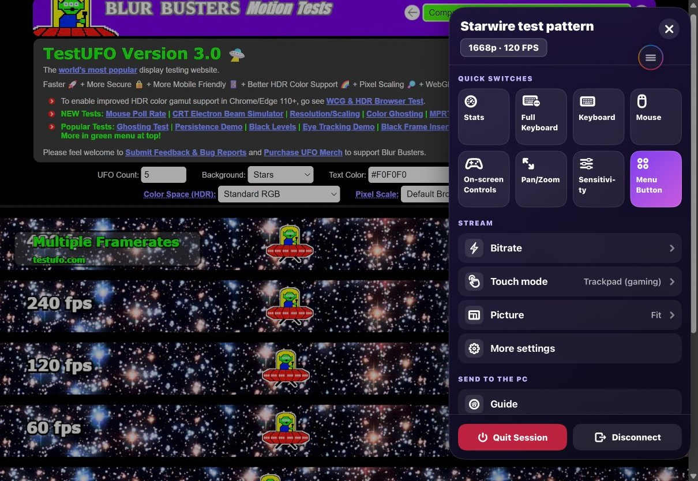
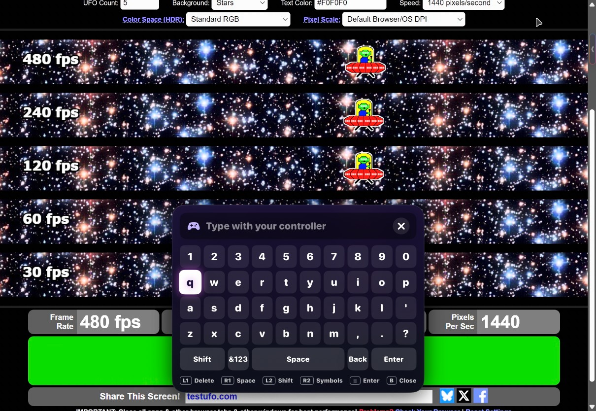
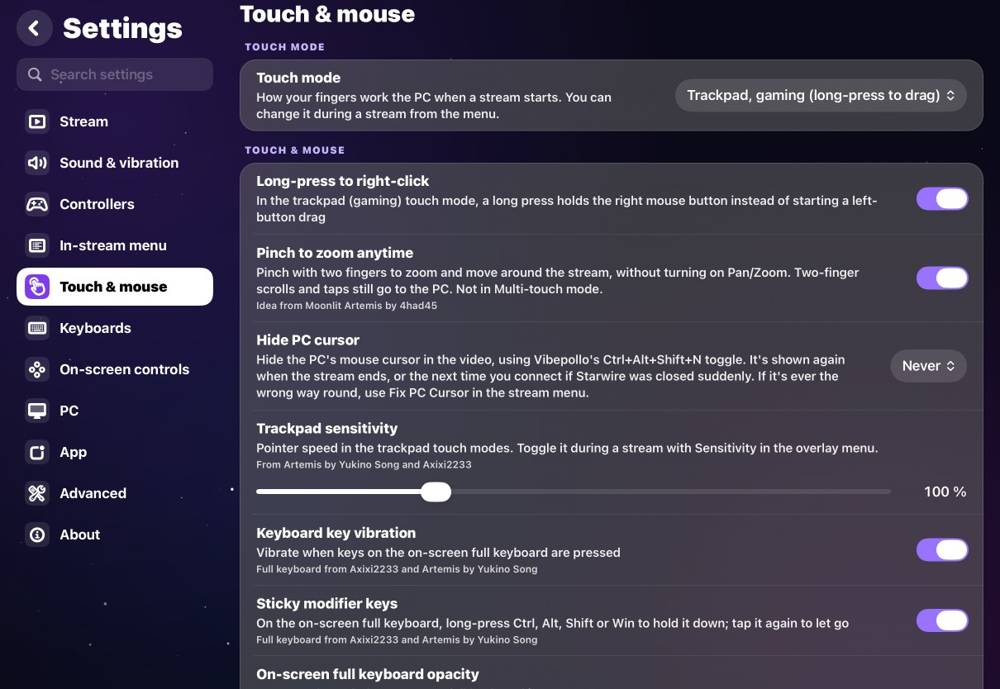

# Device run: feature/ios-batch-4-5, 2026-10-25

Batch 4.5 is the UX, settings and quality-of-life overhaul the owner asked for after trying
batch 4 ([ux-overhaul.md](../ux-overhaul.md)). Everything was built, installed and tested from the
Windows PC with `ios/scripts/mac.sh`, nobody at the Mac or the iPad. GitHub Actions wasn't used
between steps (the owner's request); `mac.sh ci` runs the same checks on the Mac.

## What was run

| | |
| --- | --- |
| Date and time (UTC) | 25 Oct 2026, about 20:50 to 22:45 |
| Branch | `feature/ios-batch-4-5`, from `cb60db91` (batch 4) |
| Who ran it | Claude Code on the Windows PC, through `mac.sh` |
| Mac | MacBook Air (M1, 2020), macOS 27.0.1, Xcode 27.0 |
| iPad | iPad Pro 11-inch (M4) "mimi love", iPadOS 27.0.1, 120 Hz. Installed over the batch 4 build; it stayed paired |
| PC and host | Vibeshine 2.0.1, "Starwire test pattern" on its own virtual display, the PC's sound kept on the PC |
| Stream | 2420x1668, 120 FPS, AV1 10-bit HDR, system presenter (the owner's settings) |
| Network | iPad on Wi-Fi, PC wired |

## Tests

| Test | Result | Notes |
| --- | --- | --- |
| `swift test` for StarwireKit | 640 passed | Windows and the Mac. 60 more than batch 4: settings carry-over, gestures, keyboards, the controller keyboard, the menu button, the menu's groups, touch rate, the latency probe, scroll pacing, device resolutions, keyboard shortcuts |
| Script tests (Python) | 46 passed | Covers, the latency app, the string catalog |
| `mac.sh ci` | all passed | Every step of GitHub's iOS workflow on the Mac: both simulator builds, the unit tests with the snapshots, the device-run build, scripts, catalog, StarwireKit. From clean once (about 25 min), then incremental (4 to 5 min) |
| Snapshots (`mac.sh snapshots record`) | recorded | iPhone and iPad simulators, light and dark, default and largest text: the stream menu and its touch-mode page, the controller keyboard, the key editor, Settings' Touch and Keyboards sections, and the settings layout again |
| `DesignDeviceRunTests/testStreamScreens`, `testOtherPlacements` | passed | Twice: before and after the design fixes |
| `DesignDeviceRunTests/testSettings` | passed | |
| `DesignDeviceRunTests/testFillTheScreen` | passed | Put the app back to full screen once (see Scrolling) |
| `InputDeviceRunTests/testStreamMenu` | passed | Batch 3's test, moved to the new menu: every item, Shortcuts (Esc reached the PC), Manage, Monitors, the Stats switch, dragging the button |
| `InputDeviceRunTests/testTouchModes` | passed | All six modes chosen from the new menu |
| `InputDeviceRunTests/testScrollSmoothness` | passed | On the test pattern and on "Starwire input latency"; below |

GitHub Actions wasn't run during the batch (the owner's request); it runs once at the end.

## Scrolling

The owner found finger scrolling laggy and it wasn't clear whether the stream or the touch
input was at fault, so it was measured first. Batch 4.5 added a "Touch rate:" line to the
statistics overlay (StarwireKit's `TouchRateMeter`: touch deliveries a second, coalesced samples,
how late each delivery was, packets a second to the PC, for the last gesture) and the device test
`testScrollSmoothness`, which drags with real synthesised fingers (two in the trackpad and direct
modes, one in multi-touch), six drags of 300 points over 0.8 s per mode.

| Touch mode | Without the touch link | With the touch link (default) | Packets to the PC |
| --- | --- | --- | --- |
| Trackpad, natural | 108 deliveries/s, 9.3 ms late (max 12.4) | 108/s, 5.8 ms (max 6.6) | 95 scrolls/s |
| Trackpad, gaming | 108/s, 8.8 ms (max 13.0) | 109/s, 8.8 ms (max 10.5) | 95 scrolls/s |
| Direct touch | 109/s, 9.1 ms (max 12.8) | 113/s, 4.0 ms (max 10.9) | 109 to 113 scrolls/s |
| Multi-touch | 88/s, 10.9 ms (max 13.6) | 109/s, 7.3 ms (max 10.2) | 90 to 110 touches/s |

What it says:
- **The iPad was the slow part, by a few milliseconds.** Touches reached the app about 9 ms after
  the finger moved, and in multi-touch only 88 times a second on a 120 Hz screen. The video's
  display link runs on its own thread, so nothing on the main thread asked UIKit for full-rate
  touch delivery. The fix (`TouchDeliveryLink`) is iOS 18's update link with low-latency event
  dispatch, on for every stream: 3 to 5 ms sooner in three modes and 109 deliveries a second in
  multi-touch. `-StarwireTouchUpdateLink NO` turns it off for comparisons.
- **Each touch delivery becomes one packet**, so the PC gets about 100 a second; nothing is held
  back or bunched up in the app. moonlight-common-c sends each scroll as its own reliable packet
  and touch moves unreliably, unmerged.
- **Slow natural-trackpad scrolls sent empty scroll packets,** one per touch: fixed, with a test.
- **The PC's side, on the "Starwire input latency" page** (added to Vibeshine with the owner's
  OK). The page flips one square on every input and another on every scroll of its list; the
  app reads both from each decoded frame. "First movement" is from the first packet of a drag to
  the frame that shows the list moved, so it includes the PC, the encoder, Wi-Fi and the decoder.

  | Touch mode | First movement, without / with the touch link | Frames in which the list moved, without / with |
  | --- | --- | --- |
  | Trackpad, natural | 48 ms / 23 ms | 73% / 74% |
  | Trackpad, gaming | not run / 23 ms | not run / 78% |
  | Direct touch | not run / 22 ms | not run / 84% |
  | Multi-touch | 97 ms / 97 ms | 54% / 79% |

  Multi-touch's 97 ms is Windows': a touch pan only starts once the finger has moved a little.
- **Scroll pacing.** About 100 scroll packets a second can't move a page in every frame of a
  120 FPS stream: a refresh that gets no touch delivery sends nothing. `ScrollPacer` sends
  scrolling once per display refresh and splits each delivery over two refreshes. Measured on
  the latency page, 8 drags per mode:

  | Touch mode | Pacing off | Pacing on (default) |
  | --- | --- | --- |
  | Trackpad, natural | moved in 81% of frames, first movement 21 ms | 87%, 21 ms |
  | Trackpad, gaming | 75%, 37 ms | 78%, 37 ms |
  | Direct touch | 68%, 21 ms | 76%, 22 ms |

  A small gain with no delay that could be measured. The rest is on the PC: the list only moves
  when Chrome draws a frame, and Chrome takes the wheel steps at its own pace.
  `-StarwireScrollPacing NO` turns it off.
- The drags are synthesised by XCTest, so their sample rate isn't a finger's; the rates and
  delays of the app's own delivery are what is compared.

An earlier run aimed its drags at the screen's edge by mistake (XCTest's first "window" has no
size); iPadOS took them as window gestures and left Starwire in a window. The window controls'
Zoom button put it back (`DesignDeviceRunTests/testFillTheScreen`), and the drags now use
XCTest's own screen points.

## The new screens on the iPad

`DesignDeviceRunTests` photographed each with the "Starwire test pattern" stream behind it; the
owner got the pictures as the design checkpoint. One picture (the docked full keyboard) was kept
back and isn't in the repo: the PC's monitors were asleep, so Windows had moved one of the
owner's own windows onto the stream's virtual display, and it showed in the stream.

These were taken before the fixes below (the menu button over the menu, "Trackpad" twice).

- **Stream menu:** opened from the floating button and from the edge tab; its Touch mode and
  Bitrate pages opened and Back returned. The touch-mode choices showed "Trackpad" twice (the
  bracketed "natural" and "gaming" were cut off as if they were controller buttons): fixed.
- **Menu button:** the floating button and the edge tab (style "edge"); the tab opened the menu.
  The button sat on top of the open menu, and the tab was too faint: the button now hides while
  the menu is open, and the tab is brighter.
- **Full keyboard:** docked, and floating at 80% with its handle.
- **Controller keyboard:** drawn over the stream (opened with a test-only launch argument, as no
  controller was connected).
- **Settings:** the sidebar, the Stream, Touch & mouse and Keyboards sections, and the search.

## Found and fixed on the iPad

1. **Touches came late** (9 to 11 ms, 88 a second in multi-touch): the touch link above.
2. **Empty scroll packets** from slow natural-trackpad scrolls: no longer sent.
3. **The stream menu's touch-mode page** showed "Trackpad" twice: only controller buttons in
   brackets are taken off a title now.
4. **The menu button covered the open menu,** and the edge tab was hard to see: the button hides
   while the menu is open; the tab is drawn at 90% of the button's opacity.
5. **The statistics overlay** didn't show the new "Touch rate:" line: a scripted edit had missed
   it; added by hand and checked on the iPad.
6. **The test pattern** once opened its Chrome window on the PC's main monitor for 30 s, while
   the monitors were asleep and the virtual display wasn't up yet. `test-pattern.ps1` now waits up
   to 20 s for a display of the stream's exact size and opens nothing otherwise. Installed on the
   PC with the owner's OK, with the four covers and the new latency app (apps.json backed up
   first each time, Vibeshine restarted once).
7. **Device runs disturbed the owner's PC:** it lagged and their keyboard stopped typing while
   streams ran, as a stream's test input goes to whatever window has focus. Device runs now wait
   for the owner's OK and happen in agreed blocks (runbook, "Rules for every run").

## Not verified

- **Controllers:** the controller keyboard was drawn but not typed on; the stream menu's
  controller moves; "last input was a controller" choosing the controller keyboard. No controller
  was connected.
- **Gesture shortcuts** (four and five-finger taps) on the device: unit tested in every mode,
  including multi-touch's cancel, not tapped on the iPad.
- **Hardware keyboard shortcuts** (Ctrl+Alt+Shift+M, S, D): no keyboard on the iPad.
- **Real fingers:** every scroll number above comes from XCTest's synthesised drags.
- **Covers** on the game screen: installed on the PC, not photographed in the app.
- **Picture fill and stretch** on the screen, the key editor and More settings over a stream: built
  and snapshot or unit tested, not opened on the iPad.
- **iPhone:** simulator snapshots only.

## Hands-on checklist

About 10 minutes on the iPad Pro.

1. **Scrolling:** start Desktop, open Chrome on the PC, scroll a long page with one finger in
   Multi-touch and with two fingers in the trackpad modes (menu > Touch mode). Does it feel better
   than before?
2. **Stream menu:** open it from the button, try Bitrate, Touch mode and Picture (Fit, Stretch,
   Fill), and More settings.
3. **Gestures:** tap with four fingers (full keyboard) and five (menu), in Multi-touch too.
4. **Menu button:** Settings > In-stream menu: try "Tab on the edge", a size, the opacity and
   "Tuck away when unused".
5. **Keyboards:** Settings > Keyboards: Gaming layout, floating, 80%; Change keys: make Caps Lock
   send Esc and try it.
6. **With a controller connected:** press Y in the menu (or use a controller, then ask for the
   keyboard): the controller keyboard; L1, R1, L2, R2, Start, B.
7. **Hardware keyboard:** Ctrl+Alt+Shift+M opens the menu, S the stats, D disconnects.
