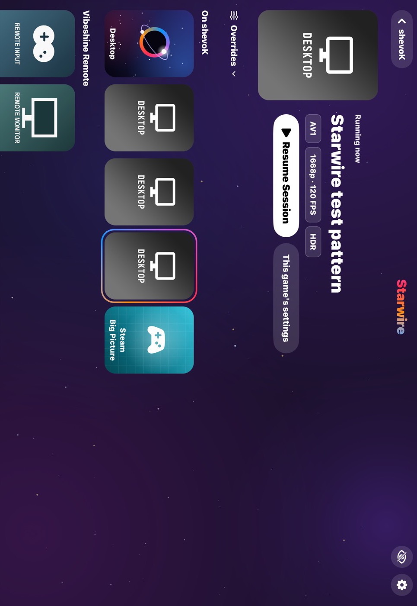
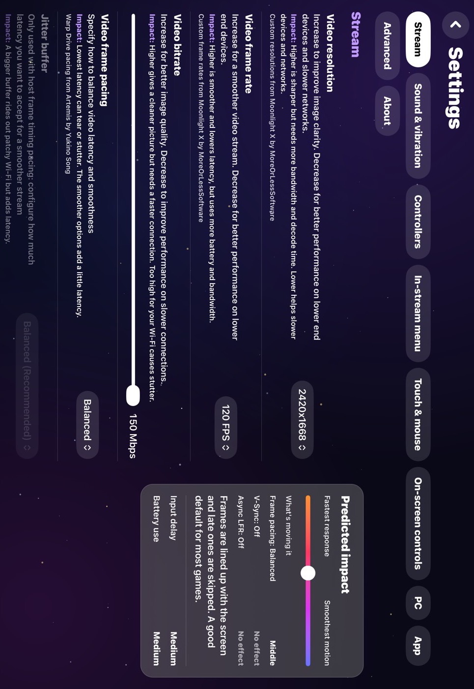
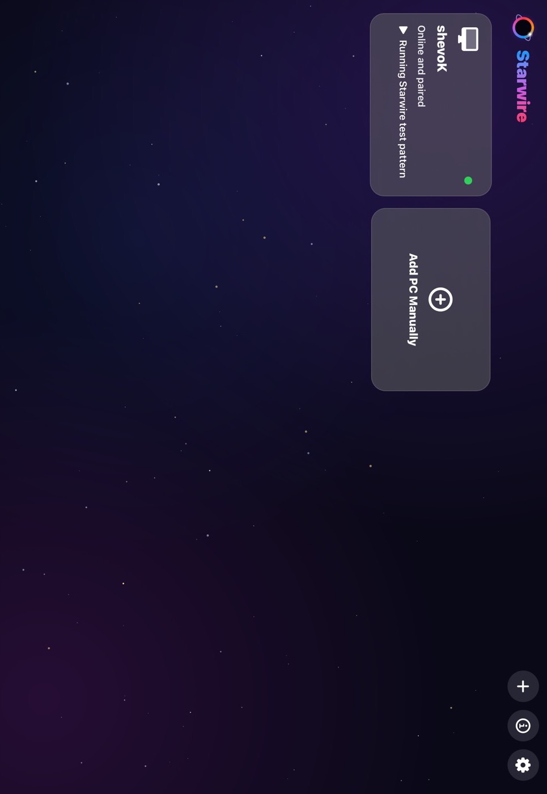

# Device run: feature/ios-batch-4, 2026-10-25

Batch 4 is phases 3 and 6 of [the plan](../port-plan.md): the app in Starwire's look, and audio
and the microphone. Every build, install and test was started from the Windows PC with
`ios/scripts/mac.sh`, with nobody at the Mac or the iPad. What needs a person (a controller, the
Pencil, hearing the stream, speaking into the microphone) is in the hands-on list at the end.

## What was run

| | |
| --- | --- |
| Date and time (UTC) | 25 Oct 2026, about 17:00 to 20:30 |
| Branch and commit | `feature/ios-batch-4`, from `3b0a8c84` (SWMC) to `ce44df0e` (the last snapshot pictures) |
| Who ran it | Claude Code on the Windows PC, through `mac.sh` |
| Mac | MacBook Air (M1, 2020), macOS 27.0.1, Xcode 27.0 |
| iPad | **iPad Pro 11-inch (M4)** "mimi love", iPadOS 27.0.1, 120 Hz. Installed over the batch 2 build; it stayed paired. The iPad 10th gen wasn't used |
| Simulators | iPhone 18 Pro and iPad Pro 13-inch (M5), iOS 27, for the unit and snapshot tests |
| PC and host | Vibeshine 2.0.1, "Starwire test pattern" on its own virtual display, the PC's sound kept on the PC (`-StarwirePlayAudioOnPC YES`) |
| Stream | The owner's settings, copied from the old settings on the first launch: 2420x1668, 120 FPS, AV1 10-bit HDR, system presenter |
| Network | iPad on Wi-Fi, PC wired |

## Tests

| Test | Result | Notes |
| --- | --- | --- |
| `swift test` for StarwireKit | 580 passed | On Windows and on the Mac. 199 more than batch 3: SWMC with the shared vectors, audio haptics, VBAN, the settings layout, impact and credits, Quick Launch, the overrides bar, controller navigation, the look, the settings export, the on-screen controller's iPad size |
| `mic-loopback.ps1` (PC) | passed | StarwireKit paired with the real receiver built into a temporary folder, on the PC's loopback, port 6995, and streamed 375 packets: all played with the same PCM; a replay and a plain VBAN packet refused |
| String tests (Python) | 42 passed | The catalog is current, and every string the app asks for is in it |
| Unit tests on the simulator | 139 passed | Including the snapshot tests on the iPhone simulator |
| `mac.sh snapshots` | passed | Every screen on the iPhone and the iPad simulator; see below |
| `AppScreensDeviceRunTests/testScreens` | passed | Every screen with the real PC, photographed, with the accessibility audit (below) |
| `AppScreensDeviceRunTests/testScreensAtLargestText` | passed | The same at the largest accessibility text size |
| `AppScreensDeviceRunTests/testDemoScreens` | passed | The same with the demo PC |
| `testDemoMode` | passed | The demo PC's stream, its taps counted, closed back to the game screen |
| `testStreamAndSample`, 180 s | passed | See "Streaming at 120 FPS" below |
| `testStreamsInARow`, 5 streams | passed | After the fix below; it crashed on the second stream before |
| `testBackgroundAndResume` | passed | |
| `InputDeviceRunTests/testTouchModes` | passed | At 120 FPS on the iPad Pro, through the new app |
| `InputDeviceRunTests/testStreamMenu`, `testOnScreenControls`, `testKeyboards` | passed | Same; the device tests now aim their gestures at the stream screen |
| `testRemoteInput` | passed | |
| `testBitrateChange` | passed | 20 then 80 Mbps, both applied by the PC |

## The app

The SwiftUI app replaces moonlight-ios's storyboard screens, which stay in the repo unused. On the
iPad Pro the screen tour (`AppScreensDeviceRunTests`) opened and photographed the game screen,
the app menu, a game's settings, the PC list, all ten settings sections, About, the licences and
the add-a-PC panel, at the default and the largest text size, with the real PC and with the demo
PC.

- **The owner's settings came over.** The first launch copied the old settings (the Core Data
  record and the iOS Settings choices) into the store once: 2420x1668, 120 FPS, 150 Mbps, AV1
  and the batch 1 pacing choices showed in the app's settings and streamed.
- **Covers.** Vibeshine's own covers show; games without one get Android's generated tiles (the
  colours checked against a Java run of Android's code), Steam Big Picture its icon tile.
- **The stream screen** is presented over the app and closes back to the game screen. The
  batch 3 input tests passed through it again (below).

### Snapshot tests

`SnapshotTests` draws each screen with the demo PC on the simulator: iPhone portrait and
landscape, iPad landscape and a third of an iPad in Split View, at the default and the largest
text size, in light and dark. The app keeps Starwire's dark look in light mode, as Android does,
and the test checks the two match. The pictures are in `ios/Tests/Snapshots/iOS27/` (80, 2.2
MB). CI's simulator is iOS 26, which has no pictures, so there the screens are drawn (and must
not crash) and the test is skipped, not passed.

They found two real problems, fixed in this batch: the hero's Play or Resume button wrapped a
letter at a time on an iPhone, and the top bars and section buttons crowded each other out at
the largest text. Those bars now grow with the text only up to the first accessibility size.

### Accessibility audit

Xcode's audit ran on every screen on the iPad Pro. At the default text size it reported 272
findings: 134 "Dynamic Type partially unsupported" (the capped bars above, and one-line list
buttons), 90 contrast failures and 23 near misses (text over the starfield, where the audit
samples the stars behind light text; the text is at least 82% white on the dark sky), 12 clipped
texts (mostly "Steam Big Picture" on its tile), 8 "potentially inaccessible text", 3 labels that
repeat their trait (Android's "... button" titles) and 2 small hit areas. The first run also
found faint grey text, clipped panel buttons and small link buttons, which were fixed. VoiceOver
itself was not used by a person.

## Streaming at 120 FPS after the UI change

`testStreamAndSample` for 180 s at the batch 1 defaults, through the new app, twice: 2420x1668 at
about 120 FPS, AV1 10-bit HDR, **0.02% and 0.01% drops**, refresh mean 8.33 ms, one network gap
of 170 and 163 ms in each run, decode about 3 ms. As smooth as batch 1. The five streams in a
row ran at 119.8 to 120.2 FPS.

## Found and fixed on the iPad

1. **A crash when a stream started right after the last one ended** (`testStreamsInARow`): the
   app now starts the next stream as soon as the stream screen closes, before the last stream's
   stop had run, and moonlight-common-c's old connection fed its frames to the new decoder. A
   new stream now stops a connection that is still running first. Five streams in a row then
   passed.
2. **The on-screen controller** used Android's grid over the whole screen height. On an iPad it
   now uses a 480-point grid along the bottom: the controls are the size they are on a large
   phone. Phones keep Android's layout exactly.

## Audio and the microphone

- **Stream audio was not checked by ear.** The device runs keep the PC's sound on the PC, as the
  owner asked, so the PC sends no audio (`2ch Opus @ 0 kbps`). The 0 kbps seen in earlier runs
  is this, not a fault. Hearing a game on the iPad is on the hands-on list.
- **The microphone** passed the shared vectors and the loopback test against the real receiver on
  the PC. The iPad was not tried: this PC has no receiver or VB-Cable installed, and a receiver
  that the iPad can reach needs a Windows Firewall rule, which `windows/setup-microphone.ps1`
  adds with administrator rights. That is the owner's to run.
- **Audio haptics**: built; there is nothing to feel on an iPad without a controller.

## Not verified

- Controllers, controller navigation of the screens, the Pencil, a hardware keyboard and mouse.
- Pairing a new PC, the network test, Wake-on-LAN, Sleep (Vibeshine 2.0.1 has no power actions).
- Quick Launch, the overrides bar, a game's own settings and Start in Virtual or Primary Display
  during a stream: unit tested, not run on the iPad.
- Settings export and import, the language page, the translations on screen (only English seen).
- Stage Manager windows; the iPhone on a real phone.

## Hands-on checklist

About 15 minutes. First run `windows\setup-microphone.ps1` on the PC (administrator rights:
VB-Cable and the firewall rule), then on the iPad:

1. **Sound:** turn off "Play audio on PC" in Settings > PC, start Desktop,
   play something on the PC: it should come out of the iPad.
2. **Microphone:** in the receiver's menu choose Pair a device. In Starwire: Settings > Sound and
   vibration > Send my microphone on, then Pair with the PC, type the code. Start a stream, allow
   the microphone when iOS asks, speak: it should be heard on the PC (VB-Cable's CABLE Output).
3. **Controller navigation:** with a controller, move around the PC list, a game screen and
   Settings with the d-pad; A presses, B goes back, Y opens a tile's menu.
4. **Pencil** (from batch 3): a stroke at each pressure curve, tilt, hover.
5. **Controllers** (from batch 3): the checklist in
   [the batch 3 report](2026-10-25-feature-ios-batch-3.md#hands-on-checklist-for-the-end-of-the-port).
